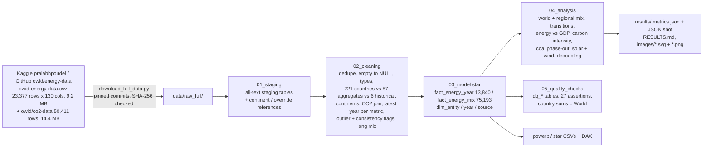

# da-learn-24 · World energy transition (Our World in Data, 1900-2025)

A data-analyst learning project on the **Our World in Data energy dataset**, the source of the Kaggle dataset *World Energy Consumption*:
**23,377 raw rows, one per entity x year from 1900 to 2025, with 130 columns** of primary energy, energy mix,
electricity mix, per-capita and carbon-intensity measures, joined with OWID's CO2 dataset (50,411 rows). The project asks how far the
world has really moved from fossil fuels, how the mix differs by region, which countries transitioned fastest since 2000, how energy use tracks
income, how clean each country's electricity is, and where coal is being phased out or still growing.

The key cleaning problem is that the `country` column is not only countries: it holds **221 real countries, 6
historical states (USSR, Yugoslavia ...) and 87 aggregates** (World, continents, income groups, EU-27 and source-specific regions such
as `Africa (EI)` or `Europe (EIA)`). Summing every row of 2023 would count world energy 9.2 times over. The SQL separates them,
assigns continents, joins CO2, picks the latest complete year per metric, flags outliers and reconciles the country sums with OWID's own World
and continent rows. DuckDB runs the whole pipeline locally on the **full** data in about 2 seconds. The outputs are a Power BI kit plus
18 charts and a dashboard as SVG and PNG in `results/images/`.

> **Databricks was skipped** for this project because the Databricks workspace hit its resource quota. There is no live Lakeview dashboard. The SQL
> stays Databricks/Spark-compatible (the DuckDB shims are isolated in `sql/00`), and all charts and KPIs are in [`results/`](results/RESULTS.md).


## Business questions
1. How fast is the world moving from fossil fuels to low-carbon energy, as a share and in absolute TWh?
2. How does the fossil vs low-carbon mix differ by region, and how did it change since 2000?
3. Which countries made the fastest transitions in electricity and in primary energy since 2000, and what drove them (solar/wind, nuclear, hydro, geothermal)?
4. How closely does energy use per person follow GDP per person, and which countries grew their economy while cutting CO2?
5. How carbon-intensive is each country's electricity, and how fast is it falling?
6. Where is coal being phased out, and where is it still growing?
7. How clean is the raw file (aggregates mixed with countries, historical states, missing ISO codes, partial years, outliers), and what had to be fixed?

## Pipeline


## Headline insights (full data)
1. **The share of fossil fuels is falling, the amount is not.** Fossil fuels supplied 86.05% of world primary energy in 2000 and 81.26% in 2024; renewables doubled from 7.43% to 14.82%. But demand grew from 110,416 to 176,737 TWh, so fossil use still rose by 47,954 TWh against 17,530 TWh of new low-carbon energy. Low-carbon additions only beat fossil additions in 2015-2020 (5,086 vs 550 TWh, with the 2020 Covid dip); in 2020-2024 fossil added 12,500 TWh and low-carbon 6,243 TWh.
2. **Electricity is where the transition is fastest.** Renewables went from 18.72% of world electricity in 2000 to 31.94% in 2024 (33.76% in the part-year 2025 release), and solar + wind from 0.21% to 15.04%. In 2024, 77 of 196 countries made at least half their power from low-carbon sources and 24 made at least 90%. Coal still made 34.07% of world power (2000: 38.02%).
3. **Regions start from very different places.** In 2024 fossil fuels were 61.3% of South America's primary energy (hydro-rich) and 73.8% of Europe's (2000: 82.0%), but 85.0% in Asia and 90.3% in Africa. Asia now uses 55.4% of the world's energy (2000: 33.4%) and coal's share of its energy rose from 36.3% to 40.0%. Europe's low-carbon share of electricity climbed from 45.5% to 62.4%.
4. **The fastest power transitions since 2000.** Among countries generating at least 10 TWh, Denmark raised its low-carbon share of electricity from 15.5% to 89.2% (+73.7 pp, solar + wind +57.2 pp), followed by Portugal (+55.4 pp), Kenya (+51.1 pp, main driver geothermal/bio) and Netherlands (+45.8 pp). The United Arab Emirates went from 0% to 31.7% (nuclear +22.9 pp). In primary energy, Denmark cut its fossil share the most (93.2% -> 58.3%).
5. **Coal: phased out in the West, booming in Asia.** World coal use rose from 27,456 TWh in 2000 to 45,851 TWh in 2024 (+67%), driven by China (8,211 -> 25,599) and India (1,911 -> 6,380), while the USA (6,287 -> 2,196) and the EU-27 (3,300 -> 1,308) fell by about two-thirds. Of the 38 countries where coal made at least 20% of power in 2000, 5 are now below 5% (Denmark 46.5% -> 4.99%, Spain 35.8% -> 0.92%, Portugal 33.8% -> 0.00%, United Kingdom 31.8% -> 0.67%, Ireland 28.9% -> 2.03%) and 6 are flat or rising, including India (68.3% -> 74.5%) and Indonesia (34.7% -> 61.5%).
6. **Grid carbon intensity.** The world's electricity got cleaner from 527 to 471 gCO2e/kWh (2000-2024); the UK fell from 522 to 216, the EU-27 from 419 to 211, the USA from 608 to 384 and China from 784 to 555, while India barely moved (740 -> 705). Among 53 grids generating at least 50 TWh the cleanest are Norway (30), Switzerland (35), Sweden (35), France (40) and the most carbon-intensive Kazakhstan (802), South Africa (717), India (705).
7. **Energy follows income, but emissions can decouple.** Across 154 countries with at least 1 million people in 2022, log energy per person and log GDP per person correlate at 0.943; 1% more GDP per person goes with about 1.18% more energy. An American used 77,628 kWh, an Indian 7,057 and an Ethiopian 642. Yet from 2005 to 2022, 43 of 153 countries grew GDP while cutting territorial CO2: the UK (GDP +21.0%, CO2 -45.5%), Germany (+32.7%, -23.0%) and the USA (+32.8%, -17.5%); China's GDP grew 213.5% and its CO2 99.1%.

Full tables, all insights and the data-quality evidence are in [`results/RESULTS.md`](results/RESULTS.md).

## Charts
All charts are in `results/images/` as SVG (plain vector shapes, no embedded raster) and PNG (2x headless-Chrome render of the same SVG).
The dashboard is [`dashboard.svg`](results/images/dashboard.svg) / [`dashboard.png`](results/images/dashboard.png).

| | |
|---|---|
|  |  |
|  |  |
|  |  |
|  |  |
|  |  |
|  |  |
|  |  |
|  |  |
|  |  |

**How the images were made:** `scripts/make_charts.py` reads the DuckDB query results exported to `results/tables/*.csv` and writes each chart as a
plain-vector SVG with the small custom writer `scripts/svgcharts.py` (rect/line/polyline/polygon/circle/text only, no plotting library).
`scripts/render_png.py` then rasterises every SVG to PNG at 2x with headless Google Chrome.

## How to run
```bash
pip install -r requirements.txt
python run_pipeline.py --source sample       # committed raw sample in data/raw/ (86 of 314 entities, 6.4 MB) -> results/sample/
python scripts/download_full_data.py         # 23.7 MB -> data/raw_full/ (OWID GitHub mirror, pinned commits, SHA-256 checked)
python run_pipeline.py --source full         # full data (~2 s of SQL): results/, data/clean/, powerbi/data/, RESULTS.md
python scripts/render_png.py                 # results/images/*.svg -> *.png with headless Chrome
```
`scripts/make_sample.py` rebuilds the committed sample from the full files. The runner stops with an error if any assertion fails: 27/27 pass on
the full data; on the sample 24 pass and the 3 reconciliation checks that need every country (country sums = World / continent rows) report
`SKIP`. `python scripts/download_full_data.py --latest` fetches the moving `master` branch instead of the pinned commits.

## Method notes
- **Countries vs aggregates.** A 3-letter `iso_code` marks a country (221, including Kosovo, whose `iso_code` is empty and gets OWID's
  code `OWID_KOS`, and Antarctica). The six historical states (USSR, Czechoslovakia, East and West Germany, Yugoslavia, Serbia and Montenegro;
  313 rows) are kept but out of rankings; they do not overlap their successors in the mix columns (EI reports the USSR to
  1984 and Russia from 1985). The other 87 entities have an empty `iso_code` (no `OWID_` codes appear in this release, but the rule
  treats them as aggregates too) and are grouped as World, Continent (OWID), Income group, EU-27, or Source region (EI / EIA / Ember / Shift).
  Country rankings use countries only; world and continent figures use OWID's own aggregate rows, and the bottom-up country sums match them
  (electricity within 1% of World 2000-2024, primary energy within 1% 2000-2023, continent low-carbon shares within 0.05 pp).
- **Continents.** From OWID's own country-to-continent table (`data/reference/owid_continents.csv`, Africa, Asia, Europe, North America,
  Oceania, South America; Antarctica by override).
- **Latest year per metric.** Coverage drops at the end of the file: EIA data end in 2023, the Energy Institute covers ~79 countries (plus World
  and continents) in 2024, Maddison GDP ends in 2022 and 2025 is a part-year Ember release (91 countries). The SQL picks, per metric, the last year
  with at least 90% of peak country coverage (`cln_latest_year`): energy mix 2024, electricity and carbon intensity 2024, GDP 2022. 2025 values are
  only quoted as provisional (106 rows flagged).
- **Shares.** Primary-energy shares use OWID's substitution method (non-fossil electricity is grossed up to the fossil input it replaces).
  Group shares are always ratios of summed TWh, never averages of percentages. Low-carbon = nuclear + renewables; renewables = hydro, solar, wind,
  bioenergy, geothermal, wave and tidal.
- **Coverage gaps.** Energy-mix shares exist only for Energy Institute countries (~79); other countries have electricity mixes (Ember, ~214) but
  not primary-energy mixes. Pre-2000 electricity source breakdowns are often incomplete (980 rows flagged), so electricity
  analysis starts in 2000. 9,537 entity-years carry only population or GDP and are left out of the facts.
- **Outliers.** Energy per person above 3x the year's 95th percentile across countries is flagged (23 rows: US Virgin
  Islands and Netherlands Antilles refinery years, Qatar 1992-1995) and left out of the energy-GDP fit. Grid carbon intensity above 900 g/kWh and above
  a generous ceiling implied by the fuel mix (coal 1,100 / oil 900 / gas 700 / other 50 g/kWh) is flagged (160 rows, e.g.
  Turkmenistan's ~1,307 g/kWh for an all-gas grid) and left out of the intensity ranking.
- **Thresholds.** Transitions: countries generating >= 10 TWh; carbon-intensity ranking >= 50 TWh; coal phase-out: coal >= 20% of power in 2000
  and >= 5 TWh generated now ("phased down" = below 5%); energy vs GDP (154 countries, 2022) and decoupling (2005 to 2022):
  countries with >= 1 million people. Decoupling uses territorial (production-based) CO2 from the OWID CO2 file.

## Repo layout
```
data/raw/            deterministic sample of the raw files (86 of 314 entities, all years; CO2 from 1900) + both codebooks; full files via scripts/download_full_data.py
data/reference/      OWID country -> continent table, entity overrides (historical states, Kosovo, Antarctica)
data/clean/          star schema from the full run (data/clean/star/*.csv, complete) + year_coverage.csv
sql/                 00 DuckDB shims, 01 staging, 02 cleaning, 03 star model, 04 analysis, 05 quality checks
run_pipeline.py      runs sql/00-05 on DuckDB and writes all outputs (--source sample | full)
scripts/             download, sample builder, chart writer (svgcharts.py, make_charts.py), PNG renderer, RESULTS.md writer, project settings
powerbi/             star CSVs, measures.dax, model.md, dashboard_spec.md, BUILD_GUIDE.md (no .pbix: needs Windows)
results/             RESULTS.md, metrics.json, JSON.shot, tables/*.csv, images/*.svg + *.png, sample/ (same pipeline on the sample)
```

## Complete dataset
This repo only holds a deterministic sample of the raw data. The complete dataset is:

- **Kaggle page:** [World Energy Consumption](https://www.kaggle.com/datasets/pralabhpoudel/world-energy-consumption) by Pralabh Poudel, a copy of
  Our World in Data's energy dataset.
- **Canonical mirror used here:** [owid/energy-data](https://github.com/owid/energy-data) (legacy release, pinned to commit `f8de88a4`; the
  energy CSV last changed on 2026-04-27) and [owid/co2-data](https://github.com/owid/co2-data) (commit `382ee6c6`, 2026-06-02):
  - `https://raw.githubusercontent.com/owid/energy-data/f8de88a4f6f9cab44f1cf606047cbd6c4414042c/owid-energy-data.csv`
  - `https://raw.githubusercontent.com/owid/energy-data/f8de88a4f6f9cab44f1cf606047cbd6c4414042c/owid-energy-codebook.csv`
  - `https://raw.githubusercontent.com/owid/co2-data/382ee6c662b0ece26e111f263b44c029afad7787/owid-co2-data.csv`
  - `https://raw.githubusercontent.com/owid/co2-data/382ee6c662b0ece26e111f263b44c029afad7787/owid-co2-codebook.csv`
  - moving branch: `https://raw.githubusercontent.com/owid/energy-data/master/owid-energy-data.csv` (OWID also publishes a new-methodology
    release at `https://catalog.ourworldindata.org/energy/owid_energy/owid_energy.csv`; it is not comparable with the legacy file used here)
  - continent reference: `https://ourworldindata.org/grapher/continents-according-to-our-world-in-data.csv` (committed in `data/reference/`)
- **Licence:** CC BY 4.0 (Our World in Data; underlying data from the Energy Institute Statistical Review, US EIA, Ember, The Shift Dataportal,
  Maddison Project and the Global Carbon Budget, credited in the codebooks).
- **Size:** 23,677,253 bytes (about 23.7 MB) in 4 files.
- **Files:**
  - `owid-energy-data.csv`: 23,377 rows x 130 columns, 314 entities, 1900-2025, 9,229,369 bytes, SHA-256 `266f2e2baad7975351bc9bb4aa061d22b1da9fe4c47d51d2ac6071e01e171f76`
  - `owid-energy-codebook.csv`: 130 rows (column, title, description, unit, source), 45,793 bytes, SHA-256 `3cc9b7db0d921496e2988568ce3aee5ed41f50431dd234a0663b5f0a4b2e32bb`
  - `owid-co2-data.csv`: 50,411 rows x 79 columns, 254 entities, 1750-2024, 14,377,942 bytes, SHA-256 `7f78e2b218ce4bb8c538bbec04fdc9a7982e8d40bff972e650df603899edd5f6`
  - `owid-co2-codebook.csv`: 79 rows, 24,149 bytes, SHA-256 `33b4f5e00efd58c7b83863f736beba1af4df946b43642b0400c3ec38648e0e8e`
- **Download:** `python scripts/download_full_data.py` (writes `data/raw_full/` and checks all four SHA-256 sums).
