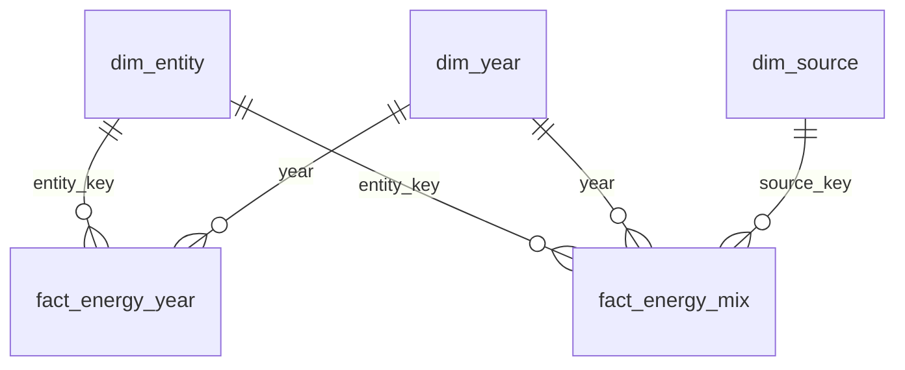

# Power BI model · da-learn-24 World energy transition

Star schema exported by `run_pipeline.py --source full` into `powerbi/data/` (same files as `data/clean/star/`). All tables are complete (no sampling).

| Table | Rows | Grain | Notes |
|---|---|---|---|
| fact_energy_year | 13,840 | entity x year with any energy or electricity value | 10,630 are real-country rows; the rest are World, continents, income groups, EU-27, EI/EIA/Ember regions and historical states. Population, GDP (to 2022), primary energy (TWh), per-capita kWh, fossil / low-carbon / renewables TWh and shares, electricity TWh and shares, grid carbon intensity, CO2 (joined from owid-co2-data), quality flags |
| fact_energy_mix | 75,193 | entity x year x source | countries, World and the six continents, 1965+; energy TWh and share, electricity TWh and share per source |
| dim_entity | 314 | entity | `entity_type` country / historical_country / aggregate, `entity_group` (Country, World, Continent (OWID), Income group, EU-27, Source region: ...), `continent` for countries, `is_country` |
| dim_year | 126 | year 1900-2025 | decade, period (pre-1965, 1965-1999, 2000-2014, 2015+), `is_partial_year` (2025 is a part-year Ember release) |
| dim_source | 9 | energy source | coal, oil, gas (fossil), nuclear, hydro, solar, wind, biofuel, other renewables; `is_low_carbon`, `is_renewable` |

Relationships: single direction, many-to-one from each fact to the dimensions. `dim_entity[continent]` is the region slicer (bottom-up from
countries); OWID's own continent rows are `entity_group = "Continent (OWID)"` and reconcile with the bottom-up sums (assertion in sql/05).

**Double-counting trap.** A naive `SUM(primary_energy_twh)` over all rows of 2023 is 923% of the World value, because aggregates repeat their
members. Every measure in `measures.dax` therefore filters `dim_entity[is_country] = 1` or reads the World row explicitly. Add a report-level
filter `dim_year[is_partial_year] = 0` unless a visual is labelled provisional.
