# RESULTS · da-learn-24 · World energy transition (Our World in Data)

All numbers below come from the **full** dataset (23,377 raw energy rows plus 50,411 CO2 rows) run through
`sql/01`-`sql/05` on DuckDB (1.5.6); nothing is estimated or hand-typed. Databricks was skipped because the workspace hit its
resource quota, so there is no live Lakeview dashboard; the SQL stays Databricks-compatible. Charts: `results/images/` (SVG + PNG).

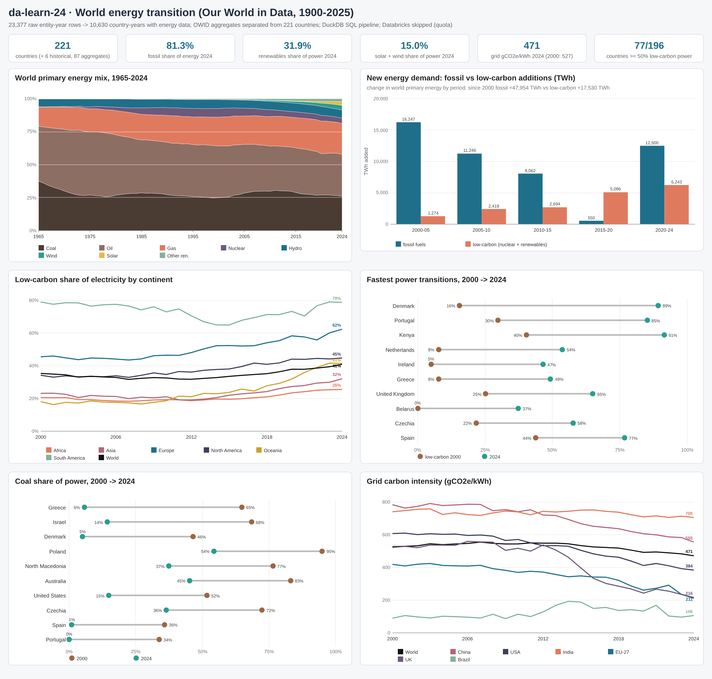

## Headline KPIs
| KPI | Value |
|---|---|
| Raw rows (energy / CO2) | 23,377 / 50,411 |
| Entities in the `country` column | 314 = 221 countries + 6 historical + 87 aggregates |
| Clean entity-years / with energy data (fact) / country-years with energy | 23,377 / 13,840 / 10,630 |
| Years | 1900-2025 (latest complete: energy mix 2024, electricity 2024, GDP 2022) |
| World primary energy 2000 / 2024 | 110,416 / 176,737 TWh |
| Fossil share of primary energy 2000 / 2024 | 86.05% / 81.26% |
| Renewables share of primary energy 2000 / 2024 | 7.43% / 14.82% |
| Fossil vs low-carbon energy added since 2000 | +47,954 vs +17,530 TWh |
| Renewables share of electricity 2000 / 2024 / 2025 (part-year) | 18.72% / 31.94% / 33.76% |
| Solar + wind share of electricity 2000 / 2024 | 0.21% / 15.04% |
| Coal share of electricity 2000 / 2024 | 38.02% / 34.07% |
| World coal use 2000 / 2024 | 27,456 / 45,851 TWh |
| Grid carbon intensity 2000 / 2024 | 527.3 / 471.1 gCO2e/kWh |
| Countries with >= 50% / >= 90% low-carbon power (2024) | 77 / 24 of 196 |
| log energy vs log GDP per person (corr / elasticity, 2022) | 0.943 / 1.18 |
| Countries with absolute decoupling (2005-2022) | 43 of 153 |
| Assertions | 27/27 PASS |

## Insights
1. **The share of fossil fuels is falling, the amount is not.** Fossil fuels supplied 86.05% of world primary energy in 2000 and 81.26% in 2024; renewables doubled from 7.43% to 14.82%. But demand grew from 110,416 to 176,737 TWh, so fossil use still rose by 47,954 TWh against 17,530 TWh of new low-carbon energy. Low-carbon additions only beat fossil additions in 2015-2020 (5,086 vs 550 TWh, with the 2020 Covid dip); in 2020-2024 fossil added 12,500 TWh and low-carbon 6,243 TWh.
2. **Electricity is where the transition is fastest.** Renewables went from 18.72% of world electricity in 2000 to 31.94% in 2024 (33.76% in the part-year 2025 release), and solar + wind from 0.21% to 15.04%. In 2024, 77 of 196 countries made at least half their power from low-carbon sources and 24 made at least 90%. Coal still made 34.07% of world power (2000: 38.02%).
3. **Regions start from very different places.** In 2024 fossil fuels were 61.3% of South America's primary energy (hydro-rich) and 73.8% of Europe's (2000: 82.0%), but 85.0% in Asia and 90.3% in Africa. Asia now uses 55.4% of the world's energy (2000: 33.4%) and coal's share of its energy rose from 36.3% to 40.0%. Europe's low-carbon share of electricity climbed from 45.5% to 62.4%.
4. **The fastest power transitions since 2000.** Among countries generating at least 10 TWh, Denmark raised its low-carbon share of electricity from 15.5% to 89.2% (+73.7 pp, solar + wind +57.2 pp), followed by Portugal (+55.4 pp), Kenya (+51.1 pp, main driver geothermal/bio) and Netherlands (+45.8 pp). The United Arab Emirates went from 0% to 31.7% (nuclear +22.9 pp). In primary energy, Denmark cut its fossil share the most (93.2% -> 58.3%).
5. **Coal: phased out in the West, booming in Asia.** World coal use rose from 27,456 TWh in 2000 to 45,851 TWh in 2024 (+67%), driven by China (8,211 -> 25,599) and India (1,911 -> 6,380), while the USA (6,287 -> 2,196) and the EU-27 (3,300 -> 1,308) fell by about two-thirds. Of the 38 countries where coal made at least 20% of power in 2000, 5 are now below 5% (Denmark 46.5% -> 4.99%, Spain 35.8% -> 0.92%, Portugal 33.8% -> 0.00%, United Kingdom 31.8% -> 0.67%, Ireland 28.9% -> 2.03%) and 6 are flat or rising, including India (68.3% -> 74.5%) and Indonesia (34.7% -> 61.5%).
6. **Grid carbon intensity.** The world's electricity got cleaner from 527 to 471 gCO2e/kWh (2000-2024); the UK fell from 522 to 216, the EU-27 from 419 to 211, the USA from 608 to 384 and China from 784 to 555, while India barely moved (740 -> 705). Among 53 grids generating at least 50 TWh the cleanest are Norway (30), Switzerland (35), Sweden (35), France (40) and the most carbon-intensive Kazakhstan (802), South Africa (717), India (705).
7. **Energy follows income, but emissions can decouple.** Across 154 countries with at least 1 million people in 2022, log energy per person and log GDP per person correlate at 0.943; 1% more GDP per person goes with about 1.18% more energy. An American used 77,628 kWh, an Indian 7,057 and an Ethiopian 642. Yet from 2005 to 2022, 43 of 153 countries grew GDP while cutting territorial CO2: the UK (GDP +21.0%, CO2 -45.5%), Germany (+32.7%, -23.0%) and the USA (+32.8%, -17.5%); China's GDP grew 213.5% and its CO2 99.1%.

## World mix
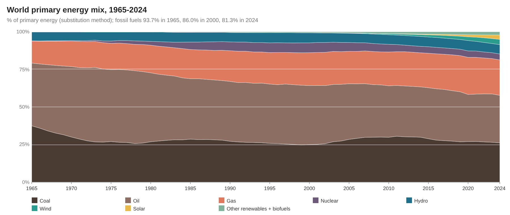
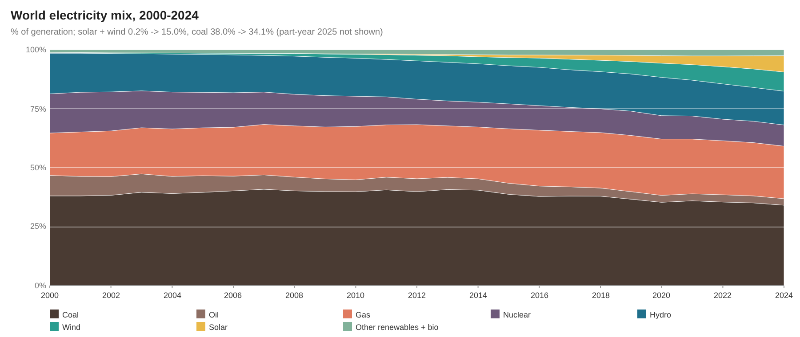
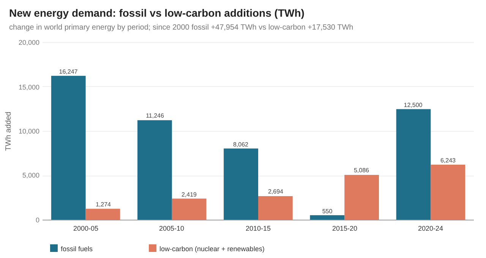

| Year | Primary energy TWh | Fossil % | Low-carbon % | Renewables % | Coal % energy | Renewables % power | Solar+wind % power | gCO2e/kWh |
|---|---|---|---|---|---|---|---|---|
| 1965 | 43,360 | 93.75 | 6.25 | 6.09 | 37.45 |  |  |  |
| 1980 | 78,011 | 91.02 | 8.98 | 6.44 | 26.88 |  |  |  |
| 2000 | 110,416 | 86.05 | 13.96 | 7.43 | 25.01 | 18.72 | 0.21 | 527.26 |
| 2010 | 141,602 | 86.51 | 13.49 | 8.37 | 29.84 | 19.72 | 1.78 | 543.85 |
| 2015 | 152,358 | 85.69 | 14.31 | 10 | 28.86 | 22.97 | 4.52 | 533.38 |
| 2020 | 157,994 | 82.98 | 17.02 | 12.78 | 26.99 | 27.99 | 9.15 | 492.11 |
| 2024 | 176,737 | 81.26 | 18.74 | 14.82 | 26.16 | 31.93 | 15.04 | 471.08 |

## Fossil vs low-carbon by region
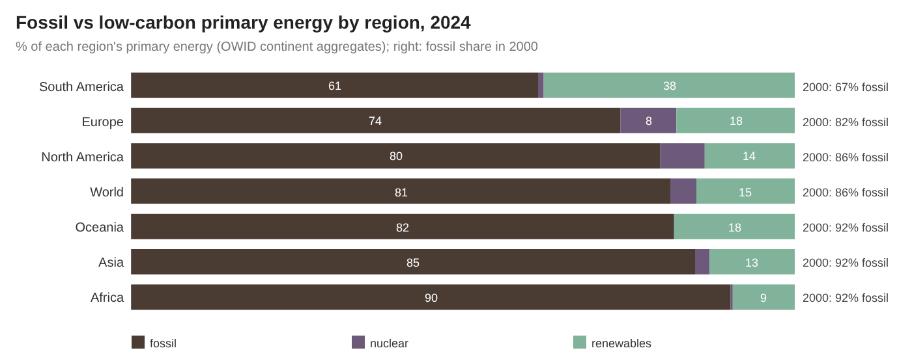
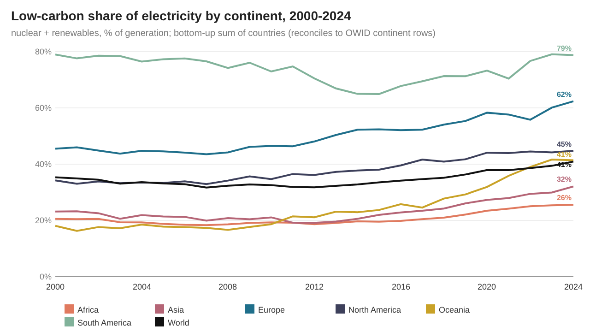

| Region | Year | TWh | % world | kWh/person | Fossil % | Nuclear % | Renewables % | Coal % | Low-carbon % power |
|---|---|---|---|---|---|---|---|---|---|
| Africa | 2000 | 3,197 | 2.9 | 3,850 | 92.05 | 1.14 | 6.81 | 30.28 | 20.52 |
| Africa | 2024 | 6,140 | 3.47 | 4,055 | 90.33 | 0.31 | 9.35 | 19.56 | 25.55 |
| Asia | 2000 | 36,891 | 33.41 | 9,846 | 91.56 | 3.79 | 4.65 | 36.28 | 23.15 |
| Asia | 2024 | 97,910 | 55.4 | 20,374 | 84.99 | 2.17 | 12.84 | 40 | 32.06 |
| Europe | 2000 | 31,106 | 28.17 | 42,662 | 82.01 | 10.6 | 7.39 | 18.08 | 45.48 |
| Europe | 2024 | 29,280 | 16.57 | 39,225 | 73.75 | 8.4 | 17.85 | 9.22 | 62.36 |
| North America | 2000 | 32,700 | 29.61 | 67,310 | 85.69 | 7.46 | 6.84 | 20.68 | 34.23 |
| North America | 2024 | 33,782 | 19.11 | 55,096 | 79.74 | 6.7 | 13.56 | 7.16 | 44.74 |
| Oceania | 2000 | 1,535 | 1.39 | 48,953 | 91.56 | 0 | 8.44 | 39.56 | 18.06 |
| Oceania | 2024 | 1,905 | 1.08 | 41,338 | 81.82 | 0 | 18.18 | 23.13 | 41.4 |
| South America | 2000 | 4,988 | 4.52 | 14,332 | 66.81 | 0.69 | 32.5 | 4.83 | 78.98 |
| South America | 2024 | 7,720 | 4.37 | 17,721 | 61.32 | 0.84 | 37.83 | 3.5 | 78.77 |
| World | 2000 | 110,416 | 100 | 17,891 | 86.05 | 6.53 | 7.43 | 25.01 | 35.34 |
| World | 2024 | 176,737 | 100 | 21,654 | 81.26 | 3.92 | 14.82 | 26.16 | 40.91 |

## Fastest transitions since 2000
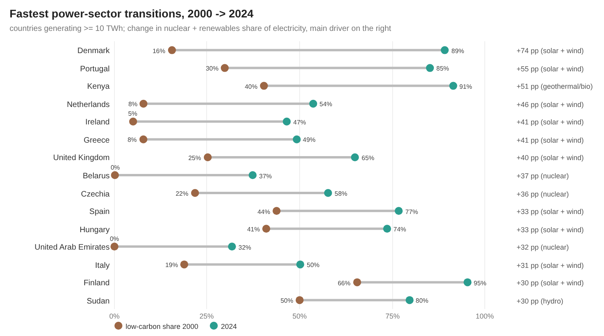
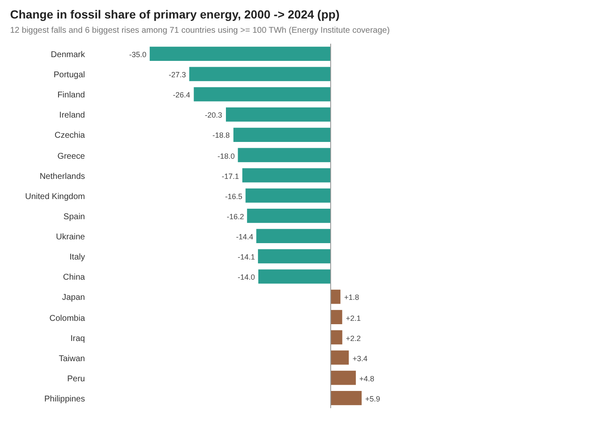

| # | Country | TWh 2024 | Low-carbon % 2000 | Low-carbon % 2024 | Change pp | Solar+wind pp | Coal pp | Nuclear pp | Geo/bio/other pp | Main driver |
|---|---|---|---|---|---|---|---|---|---|---|
| 1 | Denmark | 35.1 | 15.54 | 89.19 | 73.65 | 57.17 | -41.51 | 0 | 16.51 | solar + wind |
| 2 | Portugal | 47.3 | 29.79 | 85.19 | 55.41 | 44.94 | -33.79 | 0 | 5.16 | solar + wind |
| 3 | Kenya | 13.3 | 40.37 | 91.48 | 51.11 | 21.34 | 0 | 0 | 36.78 | geothermal/bio |
| 4 | Netherlands | 122.3 | 7.84 | 53.66 | 45.82 | 44.25 | -21.47 | -1.55 | 3.2 | solar + wind |
| 5 | Ireland | 31.1 | 5.04 | 46.53 | 41.49 | 39.77 | -26.83 | 0 | 2.84 | solar + wind |
| 6 | Greece | 57.1 | 7.82 | 49.23 | 41.41 | 40.86 | -59.08 | 0 | 1.24 | solar + wind |
| 7 | United Kingdom | 284.2 | 25.19 | 64.93 | 39.75 | 34.26 | -31.14 | -8.28 | 13.08 | solar + wind |
| 8 | Belarus | 45.8 | 0.12 | 37.32 | 37.21 | 1 | 0.04 | 34.24 | 1.2 | nuclear |
| 9 | Czechia | 72.8 | 21.77 | 57.68 | 35.91 | 5.85 | -35.93 | 22.15 | 6.68 | nuclear |
| 10 | Spain | 280.9 | 43.77 | 76.75 | 32.97 | 40.74 | -34.88 | -8.75 | 1.53 | solar + wind |
| 11 | Hungary | 38 | 40.98 | 73.63 | 32.65 | 26.03 | -20.83 | 1.86 | 4.67 | solar + wind |
| 12 | United Arab Emirates | 177.3 | 0 | 31.73 | 31.73 | 8.69 | 0 | 22.92 | 0.12 | nuclear |
| 13 | Italy | 267.6 | 18.85 | 50.17 | 31.33 | 21.54 | -8.26 | 0 | 6.3 | solar + wind |
| 14 | Finland | 82.6 | 65.54 | 95.35 | 29.81 | 25.83 | -11.13 | 7.36 | 0.24 | solar + wind |
| 15 | Sudan | 14.8 | 50 | 79.69 | 29.69 | 1.08 | 0 | 0 | -3.19 | hydro |

## Solar and wind
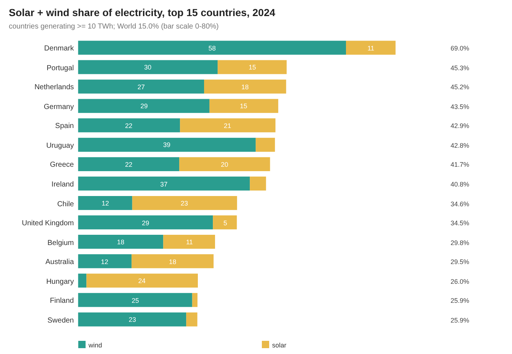
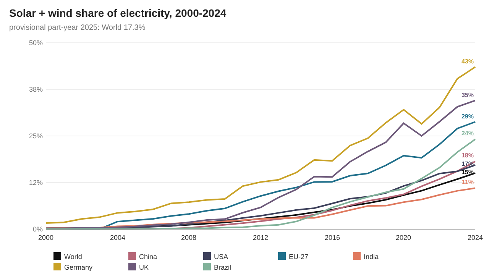
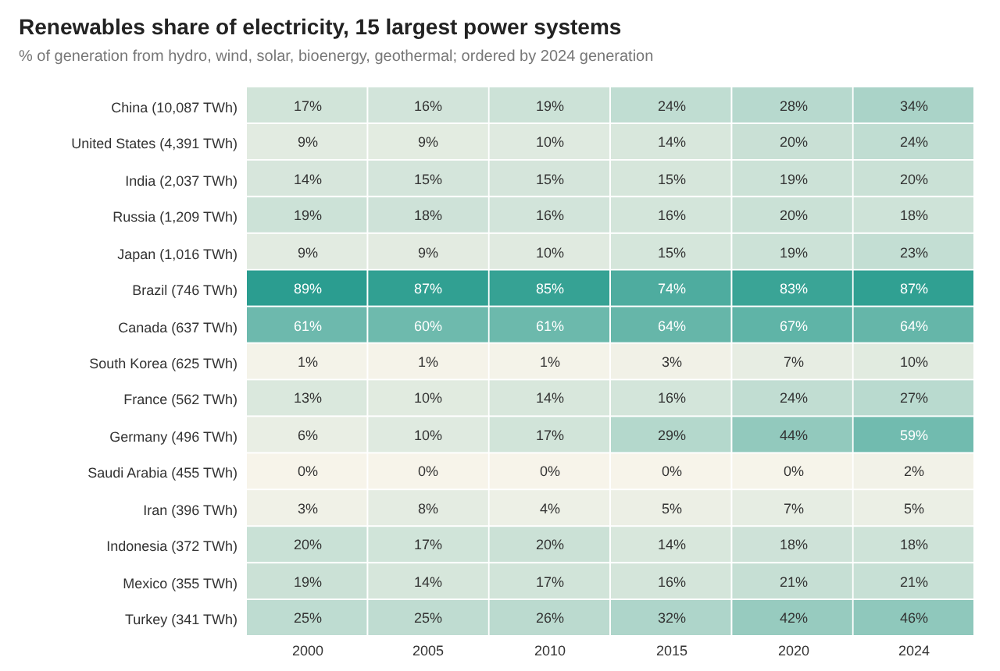

| # | Country | TWh | Wind % | Solar % | Solar+wind % | Solar+wind TWh |
|---|---|---|---|---|---|---|
| 1 | Denmark | 35.1 | 58.21 | 10.78 | 69 | 24.2 |
| 2 | Portugal | 47.3 | 30.34 | 15 | 45.34 | 21.4 |
| 3 | Netherlands | 122.3 | 27.37 | 17.84 | 45.21 | 55.3 |
| 4 | Germany | 496 | 28.55 | 14.95 | 43.49 | 215.7 |
| 5 | Spain | 280.9 | 22.14 | 20.75 | 42.89 | 120.5 |
| 6 | Uruguay | 13.4 | 38.59 | 4.19 | 42.78 | 5.7 |
| 7 | Greece | 57.1 | 21.99 | 19.73 | 41.71 | 23.8 |
| 8 | Ireland | 31.1 | 37.32 | 3.51 | 40.83 | 12.7 |
| 9 | Chile | 88.6 | 11.77 | 22.78 | 34.55 | 30.6 |
| 10 | United Kingdom | 284.2 | 29.31 | 5.21 | 34.51 | 98.1 |

## Energy per person vs GDP, and the biggest users
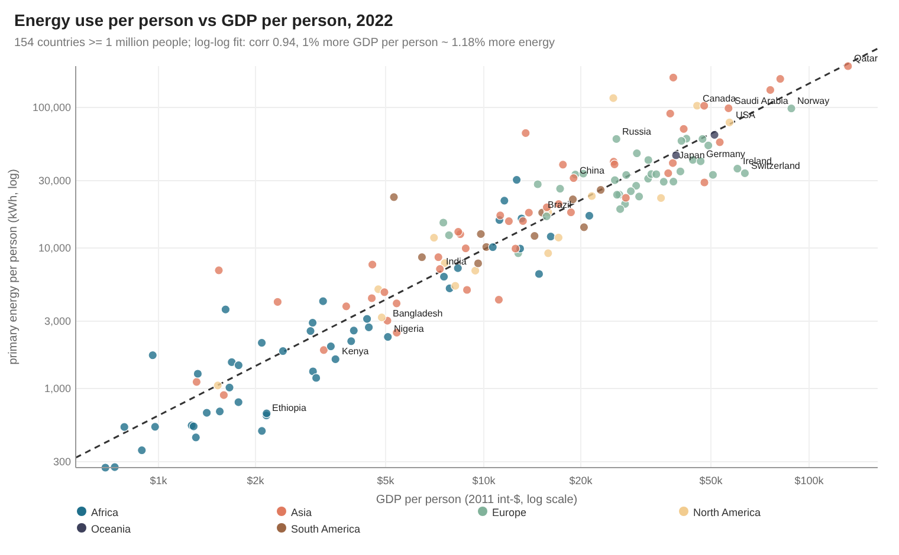
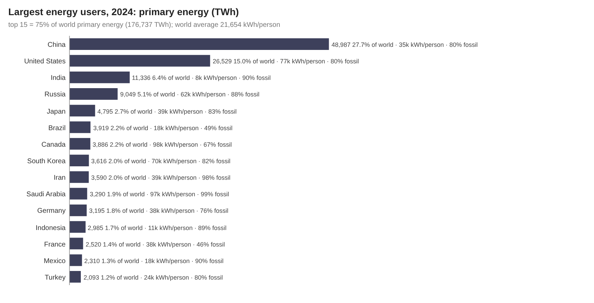

| # | Country | TWh | % world | kWh/person | x world avg | Fossil % | Renewables % |
|---|---|---|---|---|---|---|---|
| 1 | China | 48,987 | 27.72 | 34,514 | 1.59 | 80.26 | 17.47 |
| 2 | United States | 26,529 | 15.01 | 76,800 | 3.55 | 80.33 | 12.05 |
| 3 | India | 11,336 | 6.41 | 7,813 | 0.36 | 89.67 | 9.15 |
| 4 | Russia | 9,049 | 5.12 | 62,485 | 2.89 | 88.16 | 6 |
| 5 | Japan | 4,795 | 2.71 | 38,745 | 1.79 | 82.95 | 12.7 |
| 6 | Brazil | 3,919 | 2.22 | 18,486 | 0.85 | 49.38 | 49.62 |
| 7 | Canada | 3,886 | 2.2 | 97,785 | 4.52 | 67.39 | 27.16 |
| 8 | South Korea | 3,616 | 2.05 | 69,922 | 3.23 | 82.47 | 4.75 |
| 9 | Iran | 3,590 | 2.03 | 39,204 | 1.81 | 98.07 | 1.43 |
| 10 | Saudi Arabia | 3,290 | 1.86 | 96,883 | 4.47 | 99.27 | 0.73 |
| 11 | Germany | 3,195 | 1.81 | 37,793 | 1.75 | 76.03 | 23.97 |
| 12 | Indonesia | 2,985 | 1.69 | 10,529 | 0.49 | 89.05 | 10.95 |
| 13 | France | 2,520 | 1.43 | 37,866 | 1.75 | 46.14 | 16.46 |
| 14 | Mexico | 2,310 | 1.31 | 17,654 | 0.82 | 90.44 | 8.25 |
| 15 | Turkey | 2,093 | 1.18 | 23,928 | 1.11 | 80.21 | 19.79 |

## Carbon intensity of electricity
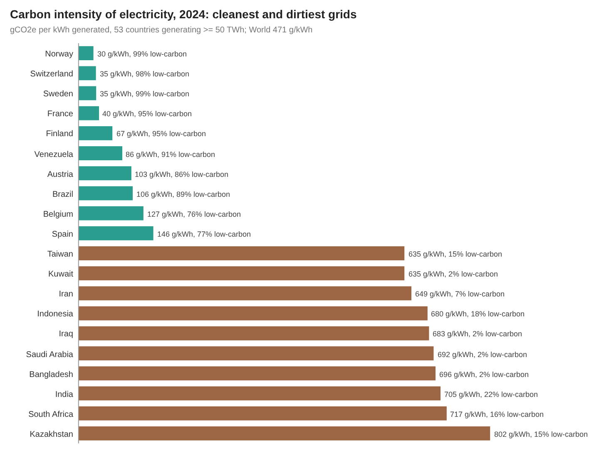
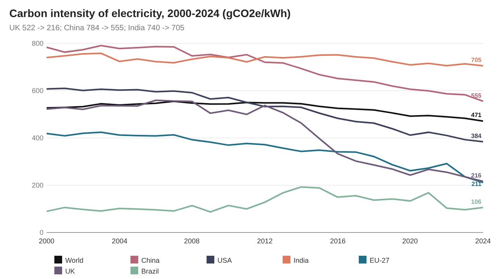

| # | Country | TWh | gCO2e/kWh | Low-carbon % | Coal % | Gas % |
|---|---|---|---|---|---|---|
| 1 | Norway | 157.1 | 29.66 | 98.61 | 0 | 0.94 |
| 2 | Switzerland | 78.4 | 34.58 | 98.1 | 0 | 0.34 |
| 3 | Sweden | 172.2 | 34.91 | 98.79 | 0 | 0.06 |
| 4 | France | 561.8 | 40.48 | 94.9 | 0.18 | 3.22 |
| 5 | Finland | 82.6 | 66.63 | 95.35 | 1 | 0.99 |
| 6 | Venezuela | 80.1 | 85.86 | 91.14 | 0 | 4.49 |
| 7 | Austria | 78.5 | 103.48 | 86.22 | 0 | 9.61 |
| 8 | Brazil | 745.7 | 106.06 | 89.45 | 2.17 | 6.54 |
| 46 | Iran | 395.8 | 648.68 | 7.18 | 0.18 | 85.92 |
| 47 | Indonesia | 371.5 | 680.25 | 18.09 | 61.48 | 18.51 |
| 48 | Iraq | 149.7 | 683.1 | 1.62 | 0 | 52.96 |
| 49 | Saudi Arabia | 454.6 | 691.95 | 2.16 | 0 | 63.34 |
| 50 | Bangladesh | 101.7 | 695.7 | 1.89 | 19.94 | 65.88 |
| 51 | India | 2,036.5 | 705.4 | 22.49 | 74.53 | 2.77 |
| 52 | South Africa | 247.5 | 717.36 | 15.66 | 83.55 | 0 |
| 53 | Kazakhstan | 118.5 | 802.04 | 15.21 | 54.03 | 29.29 |

## Coal phase-out
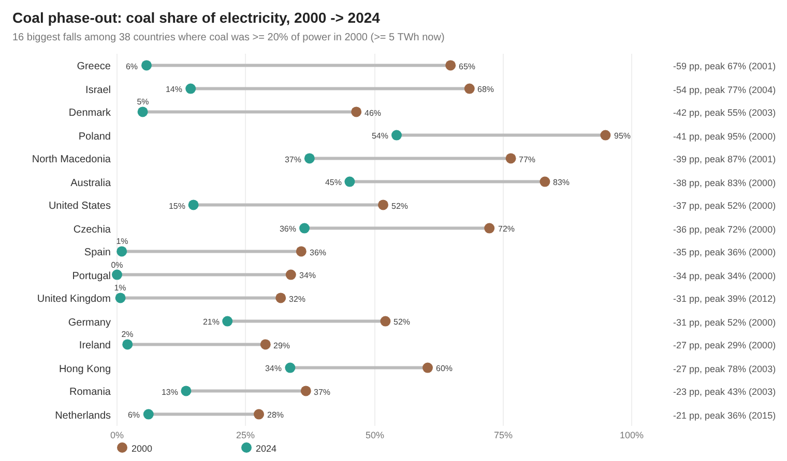
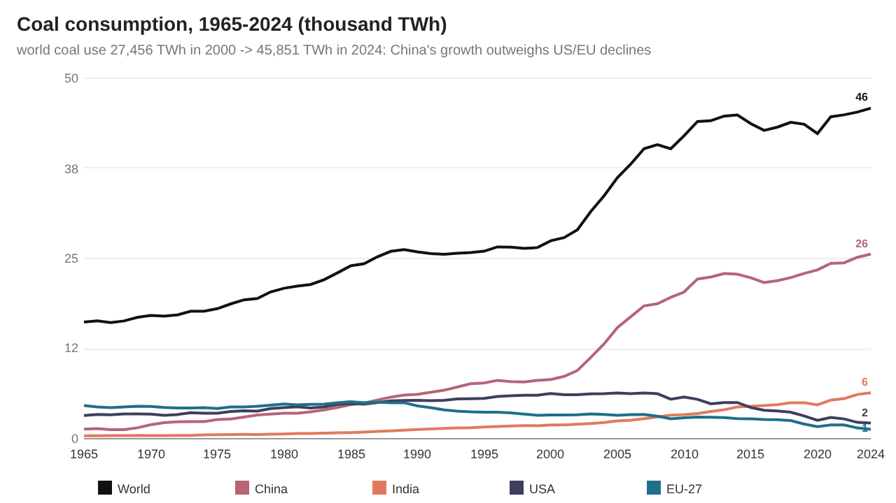

| # | Country | Coal % 2000 | Peak % | Peak year | Coal % 2024 | Change pp | Coal TWh 2024 | Status |
|---|---|---|---|---|---|---|---|---|
| 1 | Greece | 64.81 | 67.43 | 2001 | 5.73 | -59.08 | 3.3 | falling (>= 10 pp) |
| 2 | Israel | 68.5 | 77.18 | 2004 | 14.3 | -54.19 | 11.5 | falling (>= 10 pp) |
| 3 | Denmark | 46.5 | 55.06 | 2003 | 4.99 | -41.51 | 1.8 | phased down (< 5%) |
| 4 | Poland | 94.91 | 94.91 | 2000 | 54.32 | -40.59 | 93.5 | falling (>= 10 pp) |
| 5 | North Macedonia | 76.51 | 87.44 | 2001 | 37.4 | -39.1 | 2.4 | falling (>= 10 pp) |
| 6 | Australia | 83.13 | 83.13 | 2000 | 45.21 | -37.92 | 127.3 | falling (>= 10 pp) |
| 7 | United States | 51.72 | 51.72 | 2000 | 14.85 | -36.86 | 652.2 | falling (>= 10 pp) |
| 8 | Czechia | 72.36 | 72.36 | 2000 | 36.42 | -35.93 | 26.5 | falling (>= 10 pp) |
| 9 | Spain | 35.8 | 35.8 | 2000 | 0.92 | -34.88 | 2.6 | phased down (< 5%) |
| 10 | Portugal | 33.79 | 33.79 | 2000 | 0 | -33.79 | 0 | phased down (< 5%) |
| 11 | United Kingdom | 31.81 | 39.24 | 2012 | 0.67 | -31.14 | 1.9 | phased down (< 5%) |
| 12 | Germany | 52.15 | 52.15 | 2000 | 21.44 | -30.71 | 106.3 | falling (>= 10 pp) |
| 13 | Ireland | 28.86 | 28.86 | 2000 | 2.03 | -26.83 | 0.6 | phased down (< 5%) |
| 14 | Hong Kong | 60.37 | 77.84 | 2003 | 33.65 | -26.71 | 12.6 | falling (>= 10 pp) |
| 15 | Romania | 36.7 | 42.56 | 2003 | 13.43 | -23.27 | 7.1 | falling (>= 10 pp) |
| 16 | Netherlands | 27.57 | 36.14 | 2015 | 6.11 | -21.47 | 7.5 | falling (>= 10 pp) |
| 17 | Hungary | 27.25 | 27.25 | 2000 | 6.42 | -20.83 | 2.4 | falling (>= 10 pp) |
| 18 | China | 78.21 | 80.96 | 2007 | 57.77 | -20.44 | 5,827.6 | falling (>= 10 pp) |
| 19 | Bulgaria | 41.73 | 55.1 | 2011 | 22.87 | -18.86 | 8.8 | falling (>= 10 pp) |
| 20 | Kazakhstan | 69.52 | 81.1 | 2011 | 54.03 | -15.49 | 64 | falling (>= 10 pp) |
| 21 | Mongolia | 98.28 | 98.28 | 2000 | 84.69 | -13.58 | 7.5 | falling (>= 10 pp) |
| 22 | Slovenia | 33.87 | 36.95 | 2003 | 20.95 | -12.93 | 3.5 | falling (>= 10 pp) |
| 23 | Zimbabwe | 53.36 | 62.15 | 2001 | 42.89 | -10.48 | 4.4 | falling (>= 10 pp) |
| 24 | South Africa | 93.07 | 94.72 | 2006 | 83.55 | -9.52 | 206.8 | slightly lower |
| 25 | North Korea | 43.52 | 49.71 | 2019 | 34.06 | -9.46 | 9.2 | slightly lower |
| 26 | South Korea | 39.55 | 46.27 | 2009 | 30.51 | -9.05 | 190.8 | slightly lower |
| 27 | Taiwan | 48.8 | 55.49 | 2003 | 40.07 | -8.74 | 115.6 | slightly lower |
| 28 | Morocco | 68.61 | 77.63 | 2001 | 61.75 | -6.87 | 26.2 | slightly lower |
| 29 | Kosovo | 97.64 | 98.15 | 2012 | 91.29 | -6.35 | 6.2 | slightly lower |
| 30 | Chile | 20.6 | 41.52 | 2013 | 15.3 | -5.3 | 13.6 | slightly lower |
| 31 | Serbia | 67.07 | 75.51 | 2011 | 62.93 | -4.14 | 23.3 | slightly lower |
| 32 | Russia | 20.01 | 20.01 | 2000 | 17.79 | -2.22 | 215.2 | slightly lower |
| 33 | Turkey | 30.7 | 37.6 | 2019 | 35.55 | 4.85 | 121.3 | flat or rising |
| 34 | India | 68.3 | 76.96 | 2016 | 74.53 | 6.24 | 1,517.9 | flat or rising |
| 35 | Bosnia and Herzegovina | 50.72 | 75.99 | 2017 | 58.68 | 7.96 | 9.1 | flat or rising |
| 36 | Japan | 21.67 | 33.94 | 2015 | 32.19 | 10.52 | 327.1 | flat or rising |
| 37 | Indonesia | 34.68 | 61.98 | 2020 | 61.48 | 26.8 | 228.4 | flat or rising |
| 38 | Philippines | 36.78 | 63.91 | 2024 | 63.91 | 27.14 | 79.4 | flat or rising |

## Decoupling GDP from CO2 (2005-2022)
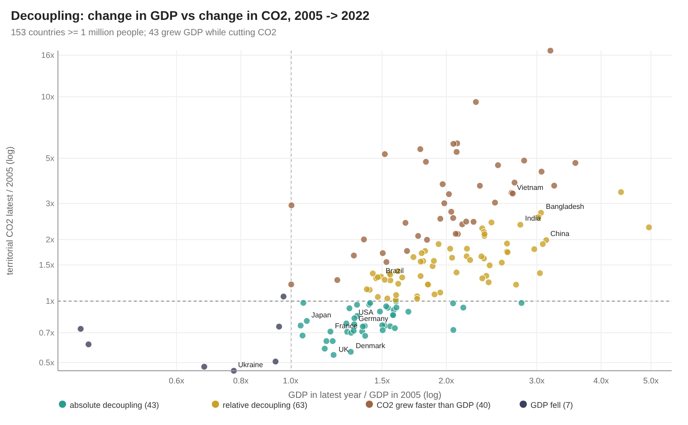

| Status | Countries |
|---|---|
| absolute decoupling | 43 |
| relative decoupling | 63 |
| CO2 grew faster than GDP | 40 |
| GDP fell | 7 |

## Data quality
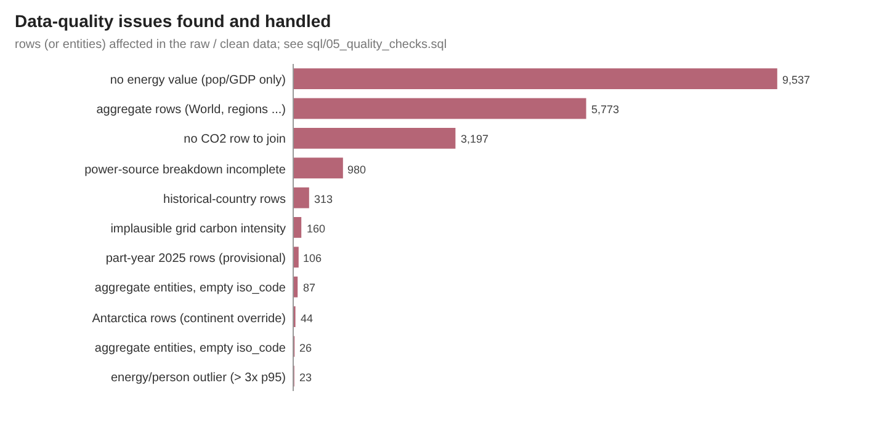

**What the `country` column contains** (the key cleaning step: only `country` rows enter country rankings)

| entity_type | entity_group | entities | entity_years | entity_years_with_energy | first_year | last_year |
|---|---|---|---|---|---|---|
| aggregate | Continent (OWID) | 6 | 751 | 361 | 1900 | 2025 |
| aggregate | European Union (27) | 1 | 126 | 61 | 1900 | 2025 |
| aggregate | Income group (World Bank) | 4 | 500 | 225 | 1900 | 2024 |
| aggregate | Source region: Ember | 12 | 322 | 322 | 1990 | 2025 |
| aggregate | Source region: Energy Institute | 30 | 1,718 | 1,260 | 1965 | 2024 |
| aggregate | Source region: Shift Dataportal | 14 | 1,398 | 0 | 1900 | 2016 |
| aggregate | Source region: US EIA | 19 | 832 | 832 | 1980 | 2023 |
| aggregate | World | 1 | 126 | 61 | 1900 | 2025 |
| country | Country | 221 | 17,291 | 10,630 | 1900 | 2025 |
| historical_country | Historical country | 6 | 313 | 88 | 1900 | 2005 |

**Row counts**

| entity | raw_rows | distinct_rows | clean_rows | grain |
|---|---|---|---|---|
| dim_entity |  |  | 314 | entity |
| dim_source |  |  | 9 | energy source |
| dim_year |  |  | 126 | year |
| entities (country column) |  |  | 314 | country / historical country / aggregate |
| fact_energy_mix |  |  | 75,193 | entity x year x source (countries, World, continents, 1965+) |
| fact_energy_year |  |  | 13,840 | entity x year with any energy or electricity value |
| fact_energy_year (countries only) |  |  | 10,630 | country x year |
| owid-co2-data rows | 50,411 | 50,411 | 50,411 | entity x year |
| owid-energy-data rows | 23,377 | 23,377 | 23,377 | entity x year (all entities) |
| real countries |  |  | 221 | ISO 3166 alpha-3 (+ Kosovo) |

**Issues found and how they were handled**

| check_name | affected_rows |
|---|---|
| Antarctica rows (ISO ATA, no OWID continent; continent set by override) | 44 |
| CO2 vs energy ISO code mismatches | 0 |
| Kosovo rows with empty iso_code (assigned OWID_KOS, kept as a country) | 26 |
| RI: clean energy rows lost in dim joins | 0 |
| aggregate entities with empty iso_code | 87 |
| aggregate rows (World, continents, income groups, EI/EIA/Ember/Shift regions) kept out of country rankings | 5,773 |
| double counting avoided: naive SUM of primary energy over ALL rows in 2023, % of World | 923 |
| duplicate entity x year keys (energy, after exact dedupe) | 0 |
| electricity source breakdown incomplete (sources <> generation by > 2%, nearly all pre-2000) | 980 |
| energy per capita > 3x the year's country p95 (flagged; refinery / tiny-population territories) | 23 |
| energy rows with no CO2 row to join | 3,197 |
| energy-mix shares outside 0..100 | 0 |
| entities with OWID_ iso prefix | 0 |
| entity-years with population/GDP only, no energy value (left out of facts) | 9,537 |
| exact duplicate rows dropped (energy) | 0 |
| fossil + low-carbon share of energy <> 100 (> 0.5 pp) | 0 |
| grid carbon intensity implausible for its fuel mix (flagged, out of intensity ranking) | 160 |
| historical-country rows (USSR, Yugoslavia, Czechoslovakia, East/West Germany, Serbia and Montenegro) | 313 |
| part-year rows after the latest complete electricity year (flagged provisional) | 106 |
| rows with unparseable year dropped | 0 |

**Null rates (real countries)**

| entity | column_name | null_pct | treatment |
|---|---|---|---|
| country-years (all) | primary_energy_consumption | 40.02 | early years and small countries have no energy data; kept as NULL |
| country-years 2000+ | carbon_intensity_elec | 3.37 | Ember; implausible values flagged |
| country-years 2000+ | co2_mt (joined) | 7.77 | CO2 file ends 2024; joined on entity + year |
| country-years 2000+ | electricity_generation | 2.91 | Ember covers ~214 countries 2000-2024 |
| country-years 2000+ | fossil_share_energy (energy mix) | 64.57 | mix only for Energy Institute countries; others in EI residual regions |
| country-years 2000+ | gdp | 32.02 | Maddison GDP ends 2022 and misses small countries |
| country-years 2000+ | population | 0.68 | per-capita measures NULL where missing |
| country-years 2000+ | primary_energy_consumption | 4.93 | 2024 only for ~79 Energy Institute countries (EIA ends 2023) |

**Assertions (27/27 PASS)**

| check_name | failed_rows | status |
|---|---|---|
| CO2 ISO codes agree with energy ISO codes | 0 | PASS |
| World row has primary energy for every year 1965..latest mix year | 0 | PASS |
| all six OWID continent rows present | 0 | PASS |
| bottom-up continent low-carbon electricity share = OWID continent row (+/- 0.05 pp) [full data only] | 0 | PASS |
| clean rows = distinct raw rows (energy) | 0 | PASS |
| countries 2000+: electricity sources sum to generation (+/- 2%) | 0 | PASS |
| countries 2000+: fossil + low-carbon electricity = generation (+/- 1%) | 0 | PASS |
| country ISO codes are 3 letters (OWID_KOS for Kosovo) | 0 | PASS |
| country rankings contain no aggregates or historical states | 0 | PASS |
| entity_key unique | 0 | PASS |
| every analysed raw column is documented in the codebook | 0 | PASS |
| every entity classified (country / historical / aggregate) | 0 | PASS |
| every real country has a continent | 0 | PASS |
| fact keys exist in dim_entity, dim_year, dim_source | 0 | PASS |
| fact_energy_year keeps every clean row with energy data (RI) | 0 | PASS |
| fossil + low-carbon share of energy = 100 (+/- 0.5) | 0 | PASS |
| nine source shares of energy sum to 100 (+/- 0.5) where all present | 0 | PASS |
| no aggregate carries a plain ISO code | 0 | PASS |
| no negative consumption or generation | 0 | PASS |
| one ISO code per entity and no ISO code shared | 0 | PASS |
| one row per entity x year (CO2) | 0 | PASS |
| one row per entity x year (energy) | 0 | PASS |
| renewables share <= low-carbon share (energy and electricity) | 0 | PASS |
| shares within 0..100 | 0 | PASS |
| sum of countries = World electricity (+/- 1%), 2000..latest [full data only] | 0 | PASS |
| sum of countries = World primary energy (+/- 1%), 2000..latest all-country year [full data only] | 0 | PASS |
| year parsed and within 1900..2030 | 0 | PASS |

## How the images were made
`scripts/make_charts.py` reads the DuckDB query results exported to `results/tables/*.csv` and writes every chart as a plain-vector SVG with the
small custom writer `scripts/svgcharts.py` (rect, line, polyline, polygon, circle and text only; no plotting library, no embedded raster).
`scripts/render_png.py` then rasterises each SVG to a PNG at 2x with headless Google Chrome. Both versions are committed in `results/images/`.

## Files
`metrics.json` (KPIs, data-quality evidence, engine, SQL timings), `JSON.shot` (headline snapshot + run config), `tables/` (every `a_*` and
`dq_*` table as CSV), `images/` (SVG + PNG), `sample/` (the same pipeline on the committed raw sample).
